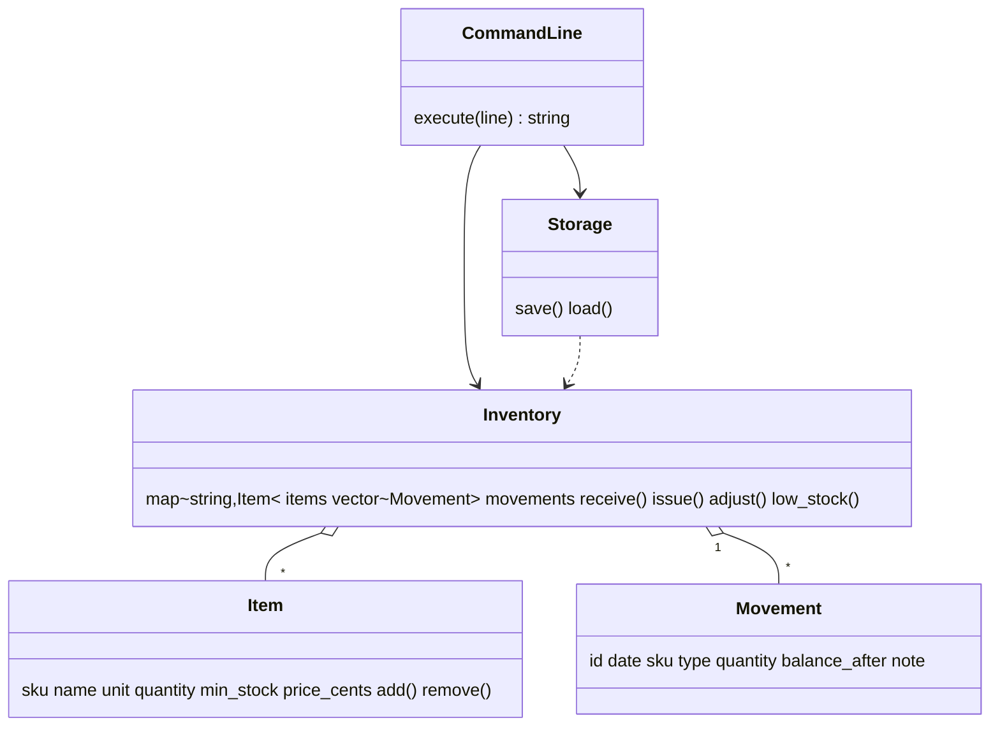

# StockKeeper

Small companies often track their warehouse in a spreadsheet: nobody knows who took what, and the stock runs out without warning. StockKeeper is a command-line warehouse tool that keeps a journal of every movement, refuses impossible operations and shows what to reorder.


## Try it in 2 minutes

```bash
cmake -S . -B build && cmake --build build
./build/stockkeeper data
```

```text
> low
Reorder list:
  DS-200    Standing desk             have 3, need at least 4, order 1 pcs
  PA-010    Printer paper A4          have 2, need at least 10, order 8 box
> issue LP-310 2 for "Team Beta"
Issued 2 x LP-310. On stock: 5.
> report
Items:            7
Below minimum:    2
Warehouse value:  12481.50 EUR
```

## Features

| Command | What it does |
|---|---|
| `add <sku> "<name>" <unit> <min> <price>` | Add an item to the catalogue |
| `receive <sku> <qty> [note]` | Goods arrived |
| `issue <sku> <qty> [note]` | Goods taken out; warns when the item drops below minimum |
| `count <sku> <qty> [note]` | Stocktaking: set the counted quantity, the difference goes to the journal |
| `stock`, `low`, `history [sku]`, `report` | Lists and totals |
| `save`, `load`, `quit` | CSV files in the data folder; `quit` asks to save first |

## Design



- **Business rules live in `Item` and `Inventory`.** The stock can never go negative; a failed operation does not write to the journal.
- **The journal is append-only.** Mistakes are fixed with a new movement (`count`), not by editing history.
- **Money in cents** (`long long`), never `double`, so `0.1 + 0.2` problems cannot happen.
- **`CommandLine::execute` returns text instead of printing it**, so every command is covered by unit tests.
- **No raw pointers, no manual memory management.** Objects are owned by standard containers.

Decisions are explained in [docs/adr](docs/adr).

## Tests

```bash
ctest --test-dir build --output-on-failure
```

22 GoogleTest tests: item rules, journal, stocktaking, CSV round trip with error line numbers, the full command-line scenario. CI builds on Linux (GCC) and Windows (MSVC).

## Run it in the browser

**Live: https://boris-plotnikov.click/stockkeeper/** — type commands in a real terminal and watch the stock table and the journal change.

The page runs this C++ code, not a JavaScript copy: the library is compiled to WebAssembly with Emscripten. `wasm/bindings.cpp` wraps Inventory, Storage and CommandLine in a small `Session` class; `web/` is a React page that calls it. The button **`</> Under the hood`** shows the C++ code behind every command, cut from the source at build time (`web/codetour.json`, `web/scripts/codetour.mjs`).

```bash
sh web/scripts/build-wasm.sh          # Emscripten in Docker -> web/src/wasm/
cd web && npm install && npm run build  # static page in web/dist
```

## Tech stack

C++17 · STL · CMake · GoogleTest · GitHub Actions · Emscripten / WebAssembly

## About

Built by Boris Plotnikov as a portfolio project. The company and the data are fictional.
